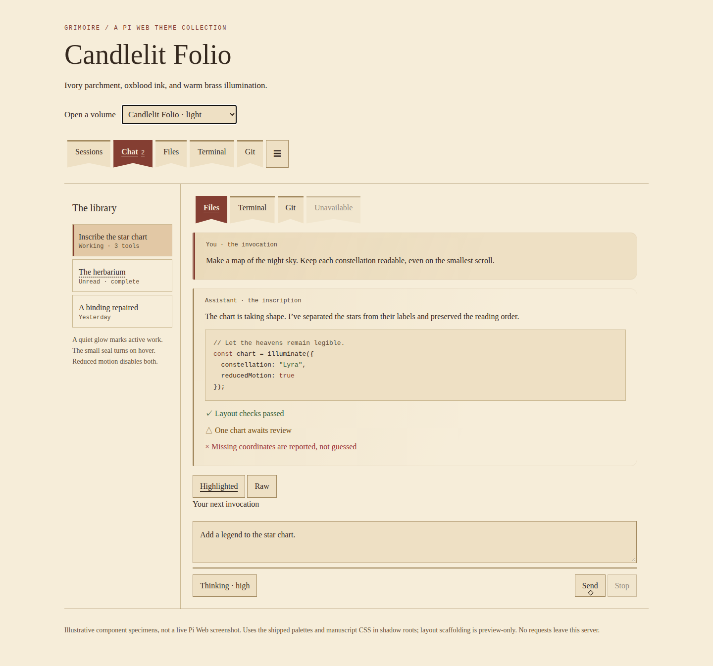
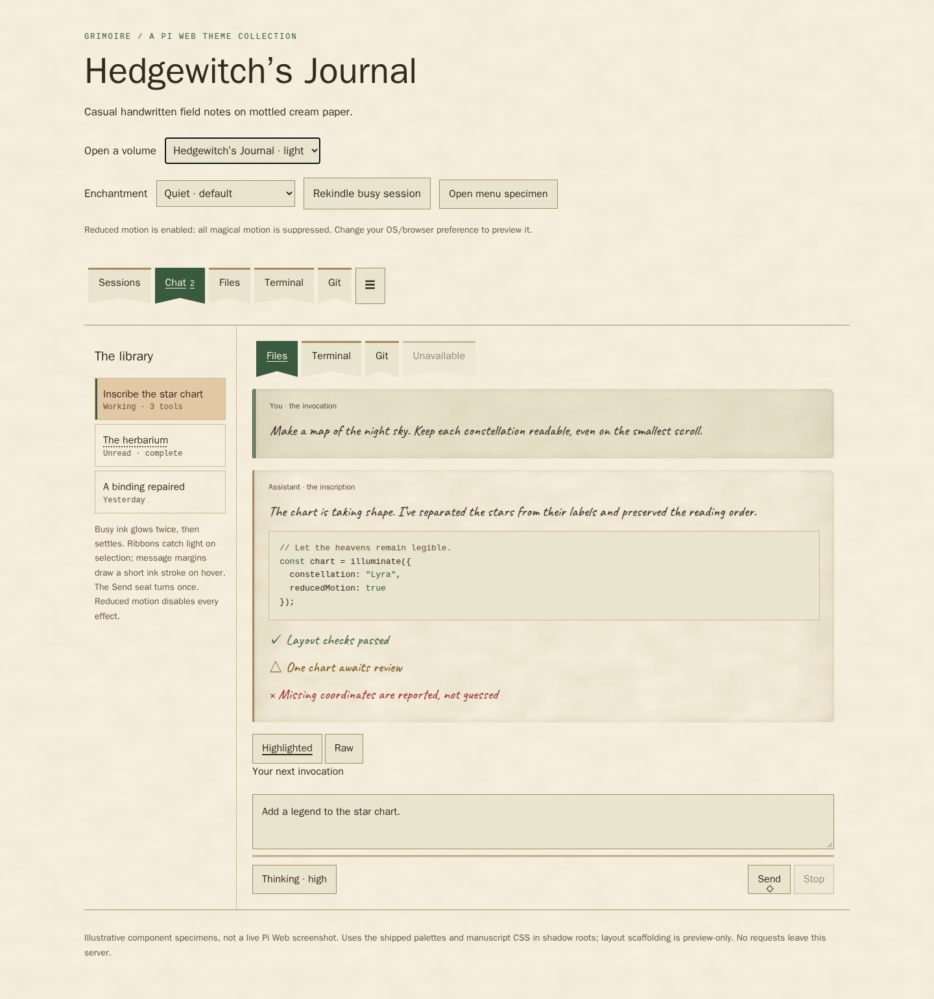

# Grimoire themes for Pi Web

Six wizardly volumes for agentic work: three quiet manuscript palettes and three more expressive, handwritten paper editions. Ink, aged pages, illuminated margins, and a small seal on the composer's default action. The visual themes leave your prompts, shortcuts, and tools unchanged. An optional **Wizardly English** language pack adds matching interface wording.

| Volume | Appearance | Character | Theme ID |
| --- | --- | --- | --- |
| **Candlelit Folio** | Light | Ivory parchment, oxblood ink, brass rules | `grimoire:candlelit` |
| **Astral Grimoire** | Dark | Midnight vellum, lilac ink, silver edges | `grimoire:astral` |
| **Verdant Codex** | Dark | Forest binding, sage lettering, botanical gold | `grimoire:verdant` |
| **Hedgewitch’s Journal** | Light | Casual Caveat handwriting, mottled cream paper, moss ink | `grimoire:hedgewitch` |
| **Scribe’s Spellbook** | Light | Calligraphic Charm handwriting, aged golden parchment | `grimoire:scribe` |
| **Forgotten Folio** | Light | Slanted Marck Script, faded paper, foxing and worn edges | `grimoire:forgotten` |

Each volume now has **Quiet** (the existing name/ID) and **Spellbound** motion editions: six palettes, twelve picker entries. Choose a `· Spellbound` entry for more expressive animation; its ID adds `-spellbound`, for example `grimoire:scribe-spellbound`. Both editions share the same static design. These are independent volumes, not an automatic light/dark pair; Auto leaves each selected edition unchanged.

See [Enchantment studies](MOTION.md) for the effect-by-effect comparison, design reasoning, limitations, and test instructions.

## Preview before installing

Static gallery captures (illustrative specimens, not live-app screenshots):



[Astral Grimoire preview](previews/astral.png) · [Verdant Codex preview](previews/verdant.png)

### Handwritten paper editions



[Scribe’s Spellbook preview](previews/scribe.png) · [Forgotten Folio preview](previews/forgotten.png)

Handwriting applies to conversation prose, not controls or code. Each edition bundles its own font and original static paper texture locally.

From this repository, run:

```sh
npm run preview
```

Open **http://127.0.0.1:4173/previews/** and choose a volume, then use **Enchantment → Quiet / Spellbound** to compare motion. Click **Rekindle busy session**, select ribbons, hover message margins and Send, or open the menu specimen. Your system reduced-motion preference always takes priority. Static PNGs do not show animation. Direct selections: [Candlelit](previews/index.html#candlelit), [Astral](previews/index.html#astral), [Verdant](previews/index.html#verdant), [Hedgewitch](previews/index.html#hedgewitch), [Scribe](previews/index.html#scribe), [Forgotten](previews/index.html#forgotten). Serve these files over HTTP; Git hosting may display HTML source rather than render it. If the repository is on a remote machine, forward port 4173 to your browser's machine. Stop the preview with Ctrl+C.

The gallery uses the actual theme CSS in shadow roots with illustrative component specimens. It is **not a screenshot of the live application** or a substitute for testing in your Pi Web version. It needs Python 3 for the included server; any static HTTP server also works. No external fonts, image services, or CDN requests are used.

## Install locally

Requires a Pi Web version supporting **declarative CSS-first themes** and the conversation/navigation/composer styling hooks. Originally authored against `@jmfederico/pi-web` **1.202610.9**; upgrade checks against **1.202611.1** are described in [Compatibility checks](docs/compatibility.md). Older runtime-only theme hosts are unsupported; styling outside the host's supported contract remains version-sensitive.

1. In Pi Web's **Settings → Pi packages**, on the **gateway machine**, install this local package source:
   ```text
   /data/projects/pi-web-grimoire-themes
   ```
   If you copied the repository elsewhere, use its actual absolute path on that machine. In Docker this must be a path accessible inside the container, preferably on a persistent mount.
2. Check **Settings → PI WEB plugins** and enable **grimoire** if disabled.
3. Reload the browser page.
4. In **Settings → General → Theme**, select any of the six volumes listed above, or its **· Spellbound** edition. The handwritten editions use the same installation—no separate font installation is needed.

Alternative developer installation: symlink this repository into the gateway's plugin directory (`$PI_WEB_DATA_DIR/plugins`, or `~/.pi-web/plugins` if unset), then reload the browser. For example, on that machine:

```sh
mkdir -p "${PI_WEB_DATA_DIR:-$HOME/.pi-web}/plugins"
ln -s /data/projects/pi-web-grimoire-themes "${PI_WEB_DATA_DIR:-$HOME/.pi-web}/plugins/grimoire"
```

Choose one installation method. Don't overwrite an existing `grimoire` link without checking its target. Theme assets are served from `assets/` only; previews and tests are not browser-public plugin assets.

**The visual themes need no session-daemon restart, server module, or browser JavaScript plugin.** The optional language pack uses a separate browser-only entry. This repository has not been installed into the live instance. It does not replace or modify Pendant. Themes installed only on a remote fleet machine are ignored by the gateway. An enforced gateway theme policy may lock the theme picker.

To uninstall, first select a built-in theme, then remove the package in Settings (or remove only the developer symlink you created) and reload the browser. CSS-only changes likewise need a browser reload.

## Optional wizardly wording

On a localization-capable Pi Web host, enable **grimoire-language** (Grimoire / Wizardly English) in **Settings → PI WEB plugins** on the gateway, then reload the browser. In **Settings → General → Language and region**, select **en-grimoire** (the picker may display it as an English variant) and apply it to this browser. The pack is disabled by default; it requires no daemon restart.

| Ordinary wording | Wizardly wording |
| --- | --- |
| Send message | Cast incantation |
| Queue message | Ready the next spell |
| Steer current response | Bend the spell |
| Thinking level / reasoning effort | Spell power |
| Thinking | Consulting the aether |
| Agent running | weaving a spell… |
| Compacting history | Bottling memories |
| Load earlier messages | Unfurl earlier scrolls |
| Action palette | Grimoire of deeds |
| Stop current work | Break the spell — stop current work |
| Clear queue | Dismiss waiting incantations |
| Remove attachment | Unbind attachment |
| Compaction cancelled | Memory bottling cancelled |

Spell power ranges from “A candlewick spark” to “By all the ancient powers”; it names reasoning effort, not an elapsed duration or a promise of correctness. Model names, reasoning values, token estimates, and shortcuts retain their technical meaning. Stop, queue removal, cancellation, and selected failures also get wizardly wording, but explicitly retain their consequences: stopping work and clearing the queue, a message not being sent, or an operation failing. Permanent deletion and confirmation dialogs remain unchanged. Unlisted text falls back to normal English. Conversations, prompts, code, and tool output are never rewritten. The full partial catalogs live in `assets/language/catalogs.js`.

Language and theme selection are independent: this wording works with all twelve Grimoire editions, stays selected when changing themes, and can also accompany other palettes. Choose **English** to restore ordinary wording, or disable **grimoire-language** and reload. Regional formats and time-zone settings remain independent. The static preview gallery does not run the language plugin.

For a live check, select the language, inspect the composer’s accessible names and spell-power picker, open the action palette, and observe a running session. Confirm Stop and failure text retain explicit operational meaning (including clearing the queue), then switch back to English and confirm ordinary labels return. Also check narrow-screen layout with the longer labels. Unit tests exercise catalog registration and copy safeguards; they do not replace these host/browser checks.

## Design and accessibility

- The original three retain their system-serif UI. The paper editions use bundled OFL handwriting fonts at 21–22px for conversation prose and a system sans-serif for controls, navigation and metadata. Code remains monospaced, and terminal geometry is unchanged. Unsupported glyphs fall back to local fonts; the handwriting fonts do not cover every writing system.
- Static local SVG textures provide mottling, fibres and foxing across the overall app canvas as well as message surfaces. The canvas texture is softened beneath a 55% base-colour wash; messages retain stronger paper detail and worn edges. Code blocks, inputs, and controls keep solid backgrounds. Shell host selectors (`pi-web-app`, `workspace-panel`) are version-sensitive and should be rechecked on host upgrades; opaque plugin-owned panels can cover the canvas. Inset shading wears the page edges without clipping text or changing hit targets. Forced colours removes the paper effects. Font loading uses `swap`, so prose remains visible while loading.
- All six themes render main navigation (Sessions, Chat, pinned tools) and workspace tool tabs (Files, Terminal, Git, etc.) as notched ribbon bookmarks. Active ribbons use the theme accent with contrasting text and an underline. Only the decorative backing is clipped: focus outlines, labels, badges and rectangular click targets remain intact. Narrow strips keep horizontal scrolling; navigation-menu and collapse buttons remain ordinary controls. These rules target the version-sensitive `app-mobile-main-tabs` and `workspace-panel` shell hosts, not arbitrary plugin tabs or renderer choices.
- User messages have a double leading rule; assistant messages a single rule. Current rows and selected choices retain structural cues, not colour alone.
- Busy sessions kindle twice (3.2s total in Quiet, 4.4s in Spellbound). Selected bookmark hems catch light, message margins draw a short ink stroke on hover/focus, the default composer seal turns once, and opening menus briefly illuminate their borders. Text, click targets and reading surfaces stay still. No ambient loops or automatic message entrances.
- All theme-owned motion requires `prefers-reduced-motion: no-preference` and inactive forced colours; changing either preference stops it immediately. Hover effects require real hover capability. Static borders, selection and focus remain. Already-selected/busy elements can animate on mount or theme change—these are decorations, not new-output or success signals.
- Native focus, disabled/hidden states, labels, popover positioning, and Stop remain owned by Pi Web. CSS never replaces text or intercepts clicks. The optional language pack changes labels through host localization only; it adds no spellcasting behavior.

## Checks and development

```sh
npm test                 # Node.js 20+; no dependencies
npm pack --dry-run       # inspect the local package contents; does not publish
```

Tests check metadata, local assets, restrained motion rules, and WCAG 4.5:1 contrast for primary/secondary/muted and semantic text against the two main opaque surfaces. They are not a blanket accessibility certification: blended surfaces, third-party plugins, focus, responsive layout, and actual host adoption also need browser checks.

`assets/{candlelit,astral,verdant,hedgewitch,scribe,forgotten}.css` define complete palettes; `assets/manuscript.css` adds shared decorations using documented hooks. The three paper editions additionally load `assets/paper.css`, `assets/fonts/`, and `assets/textures/`. All volumes load `assets/motion.css`; Spellbound editions append parameter overrides from `assets/spellbound.css`.

[Compatibility checks](docs/compatibility.md) covers Chromium checks, current-host catalog/metadata validation, and isolated tests against real PI WEB shell components. The checks use temporary loopback servers without installing the plugin or connecting to a session daemon. `previews/` remains an illustrative gallery, not the live application. No plugin build step or runtime dependencies.

CSS, gallery, and original procedural textures are MIT licensed. Bundled fonts retain their SIL OFL 1.1 licenses and copyright notices; see [asset attribution](assets/ATTRIBUTION.md). Local delivery only; no remote repository or published package is implied.
